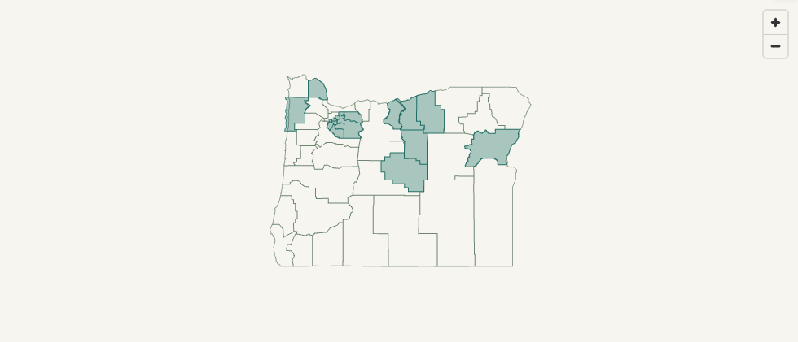
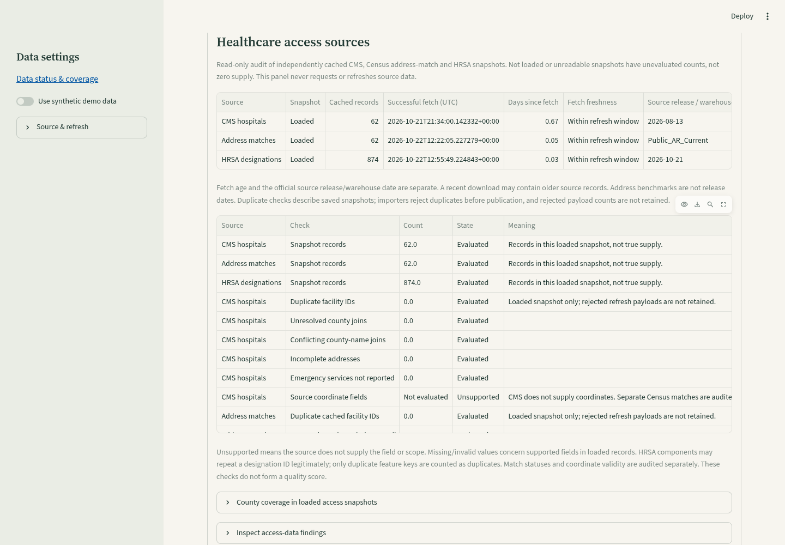
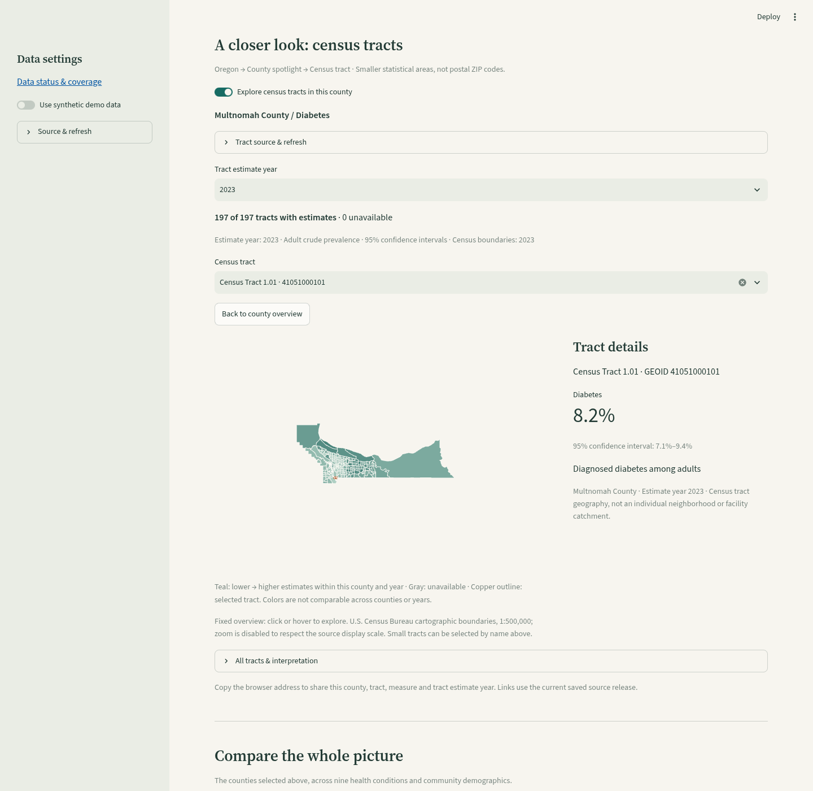
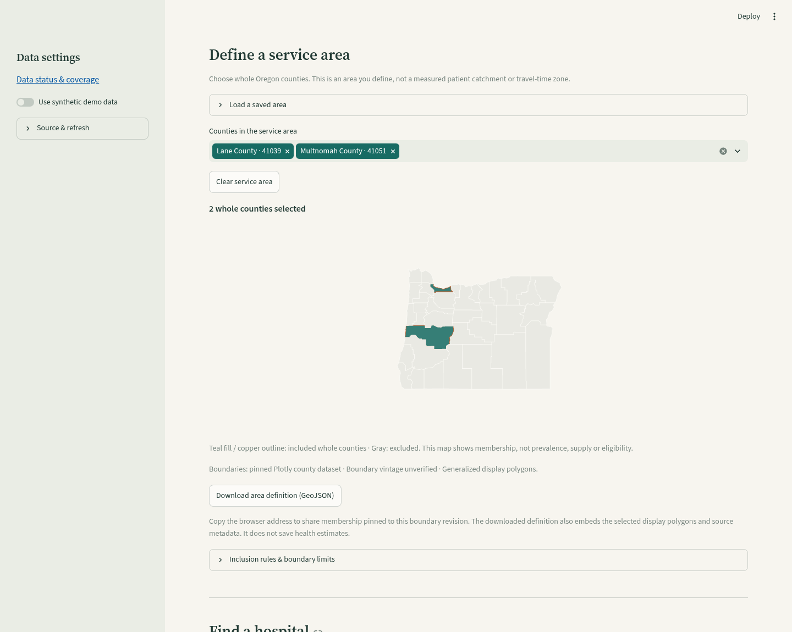
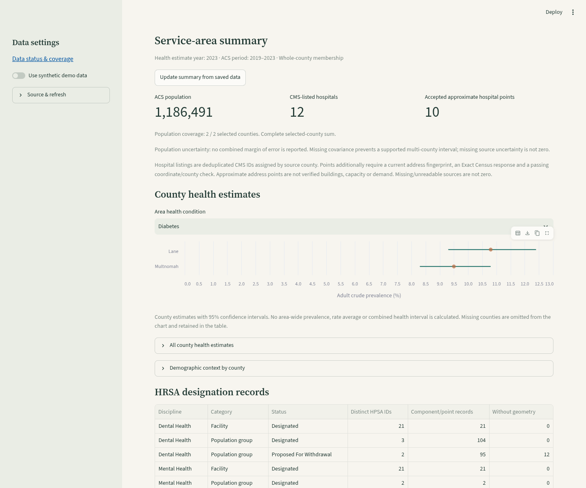
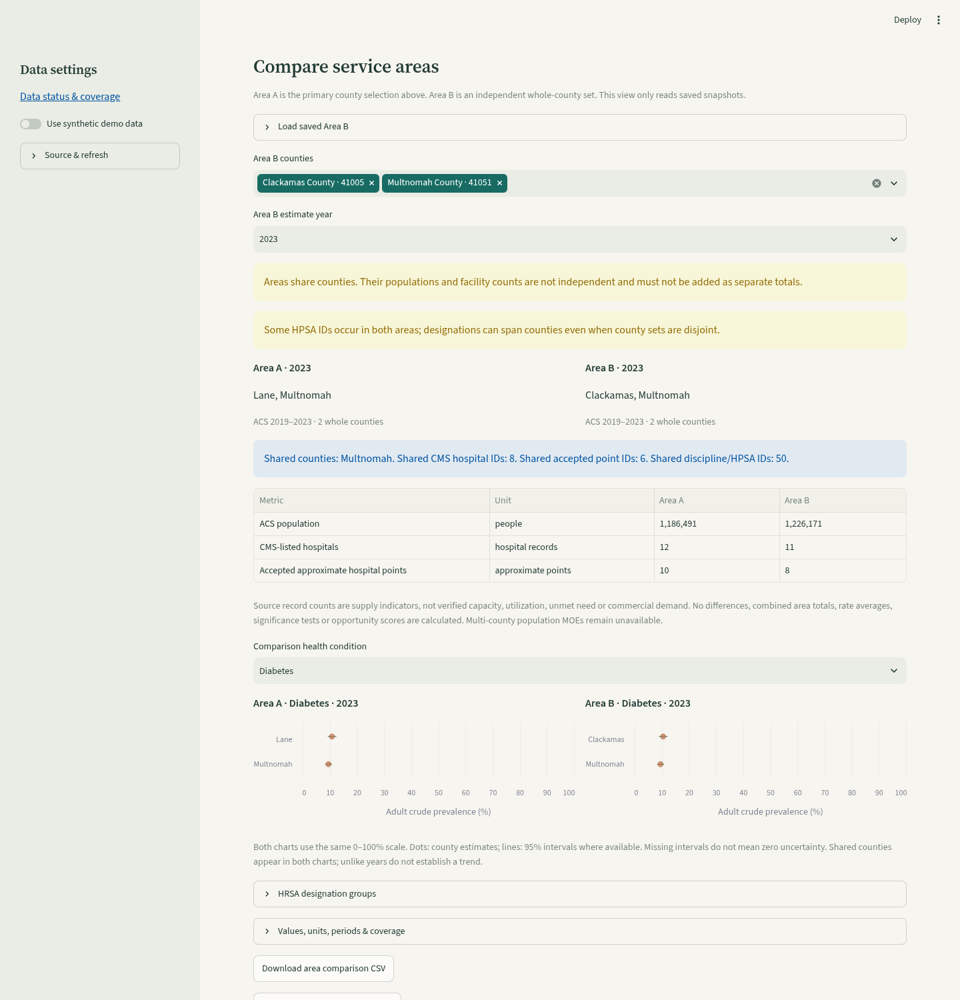

# Health Atlas

A shared Python and SQL project exploring county health in Oregon. It compares nine adult health conditions using CDC PLACES county estimates.

## Run locally

Requires Python 3.12+ and [uv](https://docs.astral.sh/uv/).

```sh
uv sync --frozen
uv run streamlit run app.py --server.address 0.0.0.0
```

Run commands from the repository root. If your home directory is read-only, set `UV_CACHE_DIR=/workspace/.cache/uv` before using uv. The app requests Oregon estimates from the public CDC Socrata API on first use, stores them in DuckDB, and refreshes a cache older than 24 hours on the next app interaction. **Refresh data** requests a download, subject to a shared five-minute cooldown. No API key is needed. Failed requests retain previously downloaded data; an empty cache shows an error and a retry button. Synthetic data is available only through the explicit **Use synthetic demo data** toggle. No real CDC data ships in this repository.

## CDC API source

The app starts with dataset ID `swc5-untb`. Live API validation confirmed this is the 2025 county release and returned 324 crude-prevalence estimates: nine measures for all 36 Oregon counties. The maintainer can set `CDC_PLACES_DATASET` before starting the app. Visitors can view the configured ID but cannot change the shared dataset. The importer checks the source title and expected fields before writing data; verify the returned release title and county coverage before interpreting results. A dataset ID selects a specific release rather than silently following an unspecified latest release.

Requests go from the Python server to `https://data.cdc.gov`, not from the browser. Hosting must permit outbound HTTPS to that domain. Anonymous requests are sufficient for this small Oregon query; no token or secret setup is required. Changing county/measure selections queries DuckDB without another API request. Refresh reservations are persisted in `data/.refresh.sqlite3` and shared across sessions and processes using the same data directory. Separate hosting replicas need a shared rate limiter; this local limit is not an edge traffic control. The importer rejects responses of 1,000 or more records, above the 324 expected for this release. A failed automatic refresh is attempted only once per source per session; **Refresh data** retries after the shared cooldown. Failed attempts count toward the cooldown to prevent repeated requests during outages.

## Optional command-line import

1. Open the [CDC PLACES data portal](https://www.cdc.gov/places/) and follow its data links to a **county, GIS-friendly** release on `data.cdc.gov`.
2. Copy its dataset ID from the URL (the `abcd-1234` portion). Choose the GIS-friendly release with one measure per row, not the wide/open-data format.
3. Run:

```sh
uv run python -m oregon_health.import_data --dataset YOUR_DATASET_ID
```

The importer verifies the dataset title, requests only Oregon crude-prevalence records for the nine measures, validates FIPS codes, duplicates and confidence intervals, and transactionally replaces `data/oregon.duckdb`. Network/validation failures preserve the existing database. Repeating an import replaces rather than appends estimates. The app uses the imported database when demo mode is off; select the same dataset ID to reuse this cache.

Required source fields: `stateabbr`, `locationid`, `locationname`, `measureid`, `year`, `data_value_type`, `data_value`, `low_confidence_limit`, `high_confidence_limit`. Missing estimates are omitted, not converted to zero. The interface displays available county counts; verify expected coverage (Oregon has 36 counties) when reviewing a release. The source title, URL and import timestamp are stored in `provenance`; estimate years are kept separately from release titles.

Live CDC access and the default dataset were verified in the cloud environment after publication. Hosting must allow `data.cdc.gov`. On a new deployment, click **Refresh data** and check coverage and source metadata; no manual file download is required.

## Data interpretation

PLACES provides modeled estimates, not patient records. This app uses crude prevalence, which is affected by county age composition. Comparisons do not imply causes or establish statistically significant differences. Confidence intervals accompany each estimate. Consult the selected release's definitions, population denominators and CDC methodology. This tool is for exploration, not medical advice.

## Contribute

See [CONTRIBUTING.md](CONTRIBUTING.md) for the issue and pull request workflow. Run `uv run pytest -q` before opening a pull request. CI uses the frozen lockfile and synthetic fixtures; tests do not require CDC access. Keep downloads, databases and personal credentials out of Git.

Project structure:

- `app.py`: Streamlit county selector, chart, uncertainty table and CSV export.
- `oregon_health/data.py`: data validation and parameterized DuckDB queries.
- `oregon_health/import_data.py`: CDC download and source metadata.
- `oregon_health/api_cache.py`: persistent API cache, expiry and refresh.
- `oregon_health/map.py`: FIPS-based geometry joins and interactive map styling.
- `oregon_health/profile.py`: validation for county links and map selection events.
- `tests/`: import, SQL and application interaction checks.

## First feature backlog

- **Data coverage report:** show missing counties/measures and explain suppressed records.
- **County context:** explain patterns using carefully sourced demographic context.
- **Age-adjusted comparisons:** import separately, expose an explicit estimate-type selector and document the difference.
- **Census integration:** join demographics by FIPS, with explicit source years and denominator checks.

Keep the first release focused on county comparisons. Add Census data once the live CDC import and coverage checks pass.

## Security and deployment

See [SECURITY.md](SECURITY.md) for security controls, known dependency findings and deployment recommendations. Bandit runs as the `bandit` GitHub Actions check; Dependabot checks Python and GitHub Actions updates weekly. Keep `test` required on main and add `bandit` after its first successful workflow run.

## County map and visual theme

The interactive Oregon map supports pan, zoom, and hover details with estimates and confidence intervals. Choose counties in the comparison control to outline them on the map and populate the chart/table. Light-to-dark teal represents lower-to-higher prevalence for the current measure/year; gray means no estimate, including counties outside the synthetic demo. The scale adjusts for each measure/year and is not suitable for comparing colors between measures.

Boundaries are bundled locally, so deployment needs no map API key, tile provider or additional GIS network access. See [boundary provenance and licensing](assets/README.md). The app joins geography and CDC estimates by five-digit FIPS codes. The warm ivory/teal/copper theme is configured in `.streamlit/config.toml`.

## County profiles and sharing

Click a county on the map to open **County spotlight**, or use the keyboard-accessible **County profile** selector immediately below the map. A profile shows three headline estimates plus a chart covering all nine conditions, with 95% confidence intervals for the selected estimate year. Missing measures say **Unavailable**; data from a different year is not silently substituted. **Add county to comparison** adds the county to the existing comparison when it has a record for the current map measure.

Selecting a profile updates the browser URL. Copy it to share the county, year, current measure and explicit synthetic demo mode. For example, `?county=41051&year=2023&measure=DIABETES&demo=0` opens Multnomah County using real data. Links refer to the deployment's configured CDC release, not an immutable historical snapshot. Unknown county IDs are ignored with a warning, and unavailable year/measure options fall back to available data shown in the controls. Clearing the profile removes the county parameter.

## Census community context

Real-data county profiles also request U.S. Census Bureau **ACS five-year Data Profiles** for the release ending in the selected health-estimate year. For example, 2023 health estimates use the ACS **2019–2023** period. No substitution to a different year is made; this integration supports release years 2015–2024 and validates variable labels before importing a release.

Fields from `https://api.census.gov/data/{year}/acs/acs5/profile`:

| Display | Estimate | Margin of error | Population universe |
| --- | --- | --- | --- |
| Population | `DP05_0001E` | `DP05_0001M` | All residents |
| Residents age 65+ | `DP05_0024PE` | `DP05_0024PM` | Share of all residents |
| Below poverty level | `DP03_0128PE` | `DP03_0128PM` | Share of people for whom poverty status is determined |

Census API requests are restricted to Oregon (`state:41`, `county:*`), require the expected set of all 36 county FIPS codes, and preserve missing/suppressed sentinel values as unavailable. Census uses **90%** margins of error; the CDC intervals shown separately use **95%** confidence. Percent margins are shown in percentage points. These datasets describe different populations and periods; displaying them together does not establish relationships or causes.

The app fetches the statewide Census release only when a real-data county profile is opened. It caches a complete snapshot in `data/census_{year}.duckdb` for 30 days, then refreshes on access. Separate county profiles reuse that same release. Failed attempts share the existing five-minute cooldown per Census release, and failed refreshes retain old snapshots with an explicit warning. A failed first fetch leaves the health profile usable with an unavailable-context message. Synthetic mode does not fetch or display real demographics.

Hosting must allow outbound HTTPS to **api.census.gov** as well as **data.cdc.gov**. Live metadata access is verified, including estimate meanings and margin-of-error attributes. The data endpoint currently redirects anonymous requests to Census’s “Missing Key” page, so a Census API key is required. After a key was configured, the 2023 Census release was validated live for all 36 Oregon counties. Multnomah County returned population 803,863, age 65+ share 14.4%, and poverty share 12.5%. Unit and UI tests use synthetic fixtures so CI does not require credentials or network access.

### Configure the Census API key

Request a key from https://api.census.gov/data/key_signup.html. Store it as `CENSUS_API_KEY` in Streamlit Community Cloud app secrets (TOML) or in the server process environment. The app reads either location; environment configuration takes precedence. Do not put the value in Git, browser controls, URLs you share, or chat.

For this Codex cloud environment, a `CENSUS_API_KEY` secret requirement with destination `api.census.gov` is saved in environment settings. Enter the value securely there, save and publish to enable live validation in this runtime. Streamlit deployment secrets and Codex environment secrets are separate configurations. Anonymous CDC PLACES access is unaffected.

The key is only sent to the fixed Census HTTPS data endpoint, as its required `key` query parameter. Requests do not follow redirects, and request exceptions are replaced with safe errors so credential-bearing request URLs do not reach application logs or the browser. Missing-key errors do not consume a refresh reservation; cached Census data remains usable without a new request.

## Side-by-side county comparison

**Compare the whole picture** uses the counties selected above the map to display all nine health measures plus population, age 65+ share and poverty in one table. Estimates are joined by county FIPS, not names, and restricted to the selected health-estimate year. The comparison preserves county selection order. Missing/suppressed values are **Unavailable**, never zero; Census values are **Not loaded** until explicitly requested.

Choose **Include Census demographics** to load community context. It reuses the statewide Census cache used by county profiles; no extra request is needed per county when that cache is fresh. Census loading is opt-in to keep the initial map fast. A missing key or failed request leaves the health comparison usable, and previously cached demographics carry a stale-data warning. Synthetic mode never loads real demographics.

Health cells show prevalence and **95% confidence intervals**. Census cells show **90% margins of error**, using `pp` for percentage points. The period column distinguishes the CDC estimate year from the ACS five-year period. Population, age and poverty do not all use the same denominator as adult health measures. These are descriptive comparisons; they do not establish causes or statistical significance.

**Download full comparison CSV** exports one row per county/measure, preserving numeric values and FIPS identifiers. Fields include estimates, interval bounds or margins of error, units, confidence levels, source periods, population universes, source references, import dates and availability status. The browser address preserves the full comparison state, including an optional open county profile.

## Share a comparison

Select counties in the desired order, choose a measure and estimate year, and optionally enable Census demographics. Copy the browser address to share that view. A fresh session restores the county order, measure, year, Census toggle and demo mode. An open county profile is included too. Empty county selections stay empty when reopened.

Example: `?compare=41051,41039,41017&year=2023&measure=OBESITY&demo=0&census=1` compares Multnomah, Lane and Deschutes with Census context. Values use the deployment's current CDC release and matching-year Census cache; links are not immutable snapshots. Census loading on a shared link still needs a configured server-side key or cached data; no credentials are included in links.

Comparison links are bounded to Oregon's 36 known FIPS codes, with duplicate codes removed. Unknown counties and counties without an estimate for the selected map measure/year are omitted with a notice. Unavailable years/measures fall back to available options with a notice. Demo mode always disables real Census loading. Older county-only links still work and use the normal initial three-county comparison. Changing between real/demo data resets the comparison to available defaults; the browser address then reflects the new selection.

Only recognized view parameters are retained in the canonical address; unrelated parameters are removed. County IDs and user-supplied link values never become SQL text, destination URLs, cache paths or credentials.

## Data status and coverage

Use the sidebar **Data status & coverage** link to inspect the status panel near the bottom of the page. Expand **Sources, freshness & missing estimates** to see the loaded CDC release, available estimate years, ACS period, last successful fetch, cache refresh window, and last recorded refresh check. This is a snapshot report, not a live uptime monitor, and inspecting it never makes a network request.

For the selected estimate year, coverage counts each of Oregon's 36 expected county FIPS codes for every measure. A missing-estimate report names the county, FIPS, measure and period and can be downloaded as CSV. **Without uncertainty** counts available point estimates without a reported confidence interval or margin of error; it does not double-count missing estimates. The report cannot infer why a source omitted an estimate. In synthetic mode, absent fixtures are explicitly distinguished from real CDC coverage gaps.

A cache older than 24 hours (CDC) or 30 days (Census) is **Refresh due**, which describes fetch age rather than the vintage of the estimate or whether a newer official release exists. Failed refreshes and missing Census-key configuration are recorded separately from coverage. Existing snapshots stay usable. If nothing has been loaded, coverage is **not evaluated**, never reported as zero. Older snapshots without refresh metadata say no outcome has been recorded yet; an old failure does not mark a newer imported snapshot as retained after failure.

Refresh outcomes are persisted in ignored `data/.source-status.sqlite3`, using only a source identifier, an outcome enum and a timestamp. Exception messages, credentials, request URLs and API key values are never stored. Cooldown-blocked actions are not recorded as new failed fetches. The status UI remains available when the initial CDC fetch fails and no health database exists.

## Navigation and mobile use

Measure and year filters are on the main page, above the map, so they remain accessible when the mobile sidebar is closed. The sidebar holds data settings and refresh controls. Page links jump to the map, county profile, full comparison or data-status panel.

The page follows **map → county profile → comparison**. Clicking a county exposes a **View county profile** link below the map. The profile's add button updates the comparison; **View comparison** and **Back to map** links connect the steps. Shared comparison/profile links retain the same state as before.

Longer map attribution, methodology and interpretation notes are in labeled expanders. Confidence intervals, margins of error, source periods, missing-value messages and refresh warnings remain available. Source import timestamps are consolidated in the data-status panel. Navigation does not add network requests or change estimates.

## Expanded conditions and charts

The 2025 CDC PLACES county release was checked live for these curated crude-prevalence measures. All nine have 2023 estimates for all 36 Oregon counties (324 records):

| Measure ID | Display name |
| --- | --- |
| DIABETES | Diabetes |
| CASTHMA | Current asthma |
| OBESITY | Obesity |
| DEPRESSION | Depression |
| COPD | COPD |
| CHD | Coronary heart disease |
| STROKE | Stroke |
| ARTHRITIS | Arthritis |
| BPHIGH | High blood pressure |

All are modeled adult prevalence estimates. Consult CDC's measure definitions and methodology for diagnosis/survey wording; these are not individual diagnoses or measurements taken by this app. Different conditions can overlap. Their percentages do not add to 100%, and the app does not create a combined risk score or health grade. Other PLACES measures with different age groups, denominators or years were not automatically mixed into this catalog.

The comparison beside the map now uses dots for estimates and lines for 95% confidence intervals. A county histogram adds a dashed county-median line: each county has equal weight, so this is not a population-weighted Oregon estimate. County profiles include an interval chart for all available conditions. The full comparison adds a prevalence heatmap with a fixed 0–100% color scale, numeric labels, and interval tooltips. Gray/— means unavailable, never zero. For legibility the heatmap shows the first three selected counties; the table and CSV keep every selected county. Confidence intervals and overlap alone do not establish statistical significance.

Refreshes record a catalog signature in the health snapshot. A cache created before this expansion triggers the existing bounded refresh workflow even if it is under 24 hours old. Failed upgrades keep the prior snapshot usable; the measure picker only offers measures present in that snapshot, and coverage reporting shows gaps. Older releases need not support every catalog measure. Demo fixtures cover nine synthetic conditions for three counties. No dependency declarations, cache files or imported data need manual edits to upgrade.

## CMS hospital import

The first facility source is CMS **Hospital General Information** (`xubh-q36u`). To download and validate the Oregon directory independently of the Streamlit app:

```sh
uv run python -m oregon_health.hospitals
```

The command reuses `data/hospitals.duckdb` for 24 hours and prints source provenance and coverage for all 36 Oregon counties. `--refresh` requests an earlier refresh, subject to the shared five-minute cooldown; `--path /tmp/hospitals.duckdb` selects a separate snapshot. No CMS API key is required. The app loads the directory only when **Show hospital directory** is selected; the health map does not wait for CMS.

The importer resolves the CSV URL through official CMS metadata, restricts downloads to the CMS HTTPS provider-data host, rejects redirects, bounds response size and row count, and checks required columns, Oregon records and unique facility identifiers. It replaces the snapshot atomically after validation. Errors leave the previous snapshot intact and return a failing exit status; a failed refresh does not advance its successful fetch time. Daily cache reuse is distinct from CMS's typical quarterly publication cadence.

Source Facility IDs and ZIPs remain strings. County names map through the existing Oregon FIPS lookup; unrecognized names and incomplete addresses stay visible in coverage. Missing emergency-services values remain unknown rather than No. Provenance retains dataset and download URLs, released/modified dates, successful UTC fetch time and a content SHA-256. Read-only `directory()` and `coverage()` helpers never make network requests.

CMS does not supply coordinates in this file. The importer creates no coordinates or map markers; optional Census address matching retains its own source and match quality. County counts describe hospitals listed by this dataset, not all healthcare services, service capacity or market demand. Zero records in a county does not mean no healthcare is available. CMS's [hospital dictionary](https://data.cms.gov/provider-data/sites/default/files/data_dictionaries/hospital/HOSPITAL_Data_Dictionary.pdf) permits public-domain reuse and requests attribution; commercial use must not imply government endorsement. The [source contract](https://github.com/elitay152/health-atlas/issues/18) and [CMS research](https://github.com/elitay152/health-atlas/issues/15) document interpretation and source selection.

## Explore hospitals

Use the **Hospitals** page link, then **Show hospital directory** to load CMS-listed Oregon hospitals. Search by name, city, ZIP, street address, county, type or facility ID, and combine the search with county and hospital-type filters. Search is literal and case-insensitive. All 36 counties remain selectable, including counties with no records; unresolved county links are a separate filter. Clear filters to broaden an empty result.

Choose a hospital from the details selector to see its address, source Facility ID, type, ownership and reported emergency-services status. Missing fields say **Not reported**. **View [county] County profile** connects to community health context; county estimates describe residents, not that hospital's patients. Facility release dates are displayed independently of the selected health estimate year. Hospital filters are local to the session and are not included in shared comparison links.

**Download filtered hospital CSV** retains source fields, IDs, county join keys, emergency-service availability, release/modified dates, UTC fetch time, source URL and content hash. Missing values remain empty with explicit status fields. Potential spreadsheet formulas in source text are escaped; import ID and ZIP columns as text to retain leading zeros.

**Coverage & interpretation** reports all county counts and unresolved/missing fields. The summary shows statewide listed hospitals, represented counties and records reporting emergency services; these are source counts, not capacity or demand estimates. The CMS source has no coordinates; optional Census address matching supplies separately labeled approximate points. Public reporting does not guarantee current operation, service availability or comprehensive facility coverage.

CMS is opt-in and uses the shared daily cache. A failed refresh retains readable records with a warning and source dates. The app attempts an automatic refresh once per session when due, avoiding repeated retries on every filter change; **Refresh hospital directory** retries subject to the shared five-minute cooldown. CMS failures leave health estimates usable, and the directory can load even when CDC data is unavailable. Synthetic mode disables real hospital listings and makes no CMS requests.

## Approximate hospital locations

In the hospital directory, select **Show approximate hospital locations** to match the loaded hospitals' public addresses using the [Census Geocoder](https://geocoding.geo.census.gov/). No API key or map-tile service is needed. Only the published facility ID, street, city, state and ZIP are sent; search text, health estimates, patient data and Census API keys are not sent. Hosting must allow `geocoding.geo.census.gov` in addition to the existing data hosts.

The map displays **approximate address points**, not verified buildings, entrances, hospital campuses, catchment areas or travel times. Census may interpolate a point along a street. An **Exact** address match is not physical site verification. The [official API guide](https://geocoding.geo.census.gov/geocoder/Geocoding_Services_API.pdf) states that coordinates are calculated along an address range. Only exact matches with finite Oregon coordinates that fall within the hospital's source county are mapped. The bundled county geometry is generalized, so border mismatches are withheld for review rather than declared incorrect. Tied, non-exact, unmatched, incomplete-address and unresolved-county records remain in the searchable directory without markers; no ZIP/county centroids or name-based guesses are used.

Copper points are address matches; teal identifies the selected hospital. The map follows the directory filters. Click a point to select its details below, or use the existing accessible details selector. County boundaries are separate from health prevalence colors. **Address-match quality** reports all loaded records by status; the map caption reports the filtered subset. County context continues to describe residents, not hospital patients.

Matches use the `Public_AR_Current` benchmark, resolved to its current Census ID at fetch time. A separate ignored `data/hospital_locations.duckdb` snapshot retains per-record address fingerprints, match status, accepted coordinates, matched address, benchmark name/ID and successful UTC match time. Matches are cached for 30 days and refreshed when source addresses/county links change. Failed refreshes preserve the old snapshot; changed addresses never inherit old coordinates. Manual **Refresh address matches** and automatic attempts use the existing five-minute shared cooldown, with one automatic attempt per address set per session.

Hospital CSV exports include optional coordinate fields, location status, matched address, address fingerprint and separate geocoder source/benchmark/fetch metadata. Without matching, coordinates remain empty and the status is `not_geocoded`. CMS release dates and geocoder match times remain distinct. A Census outage leaves the hospital directory and health estimates available. Synthetic mode never requests or displays real hospital address matches.

## HRSA shortage designations

Use **Shortage designations → Show HRSA shortage designations** to load Oregon records from HRSA's [official GIS service](https://gisportal.hrsa.gov/server/rest/services/Shortage/HealthProfessionalShortageAreas_FS/MapServer), documented on its [GIS developer page](https://data.hrsa.gov/tools/gis-developer-tools). Select a discipline, designation category, statuses and component/facility county. The default status is **Designated**. **Proposed For Withdrawal** remains a separate status and is not treated as a completed withdrawal. The public GIS view is not a full historical inventory: the verified view contains designated/proposed-withdrawal records, while the separate [HRSA CSV downloads](https://data.hrsa.gov/data/download?data=SHORT) also contain withdrawn history.

Geographic designations, population-group designations and facility designations are displayed separately. Population boundaries refer to the reported group, not every resident. Facility points are HRSA designation records, not CMS hospital identifiers or verified entrances. The map is separate from health prevalence coloring. Hover for source labels, click a feature to open its record, or use the accessible details selector. A dark outline identifies the selected record.

One designation may contain many geographic components and overlap other designations. Metrics distinguish distinct HPSA IDs from component/point rows and missing geometry; no rows are counted as people or clinicians. HPSA IDs may contain letters and are preserved as strings, separately from CMS IDs and NPIs. Geography IDs and component types are retained without assuming current census vintages. County filters identify source components/points, not whole-county shortage status. Historical/common county identifiers can represent best-matching current geography; unresolved links remain explicit. The map does not determine address-level eligibility, service capacity, unmet demand or purchase intent, and no combined shortage/prevalence score is calculated.

The importer queries source object IDs for Oregon and fetches bounded batches of up to 100, validating layer schemas, disciplines, status meanings, complete ID coverage, duplicates, coordinates and polygon structure. It uses HRSA component polygons and facility points, not reconstructed county areas. Geometry is generalized by the source query at **0.005 degrees** for display; null geometry remains in the table and coverage count. HRSA's public service is documented for use in custom applications; its inspected item metadata has no separate `licenseInfo` text. Attribution and source links are retained without asserting government endorsement.

A separate ignored `data/hrsa.duckdb` snapshot retains source records, designation/component identifiers, source designation/update/withdrawal and warehouse dates, layer metadata, generalization and UTC fetch time. Layer/object IDs identify snapshot features; they are not durable cross-release component IDs. UI selections reset when the snapshot changes. CSV downloads preserve source fields and provenance, escaping potential spreadsheet formulas; import identifier columns as text. The public source refresh cycle is daily; the local cache is 24 hours, with a shared five-minute refresh cooldown and one automatic attempt per session. Failed refreshes preserve the last good snapshot with a warning. HRSA failure does not prevent hospital or health exploration; synthetic mode never loads real HRSA data.

No API key is required. Hosting must allow **gisportal.hrsa.gov** (and **data.hrsa.gov** for official source pages/downloads). To import and print coverage without the app:

```sh
uv run python -m oregon_health.hrsa
```

Example: primary-care geographic designations with **Designated** status, using HRSA warehouse data dated 2026-10-21. This is a captured display, not a current eligibility determination.



## Audit healthcare-access snapshots

The **Data status & coverage → Sources, freshness & missing estimates** panel now includes **Healthcare access sources**. It reads the saved CMS hospital, Census address-match and HRSA snapshots without fetching data, reserving refreshes, creating caches or changing records. It remains independent of the source-view toggles.

The summary separates snapshot availability, saved record counts, successful fetch time/age, cache freshness, source release/warehouse date or address benchmark, and the last recorded refresh outcome. A failed refresh marks a snapshot as retained only when that failure is newer than its successful fetch; an older failure does not mislabel a newer snapshot. This is not a live service-uptime check. A recent fetch does not prove the source's release is current.

Checks distinguish **not evaluated** (no readable snapshot or a missing join dependency), **unsupported** (CMS supplies no coordinates; the HRSA GIS view is not complete withdrawn history), and missing/invalid values in loaded records. Audits cover snapshot key duplicates, incomplete addresses, unknown emergency-services status, unresolved/conflicting county joins, invalid/missing accepted coordinates, changed hospital addresses, cached IDs absent from the current directory, and missing/invalid HRSA geometry. An Exact geocoder response remains an approximate address match; it is not a verified site and its coordinates are checked separately.

Duplicate counts refer to saved snapshot keys. The importers reject duplicates before publishing; rejected-payload counts/reasons are not retained and must not be inferred as zero from a clean saved snapshot. Repeated HPSA designation IDs across distinct components are expected. County coverage distinguishes component/point rows from distinct discipline/designation pairs. A zero is only a count of records in a loaded snapshot, not evidence of no healthcare supply, no shortages or no demand. Unavailable snapshots have unevaluated county counts rather than zeros.

**Download access-quality checks** exports counts, evaluation states and explanations. **Download access-quality findings** exports record IDs and controlled descriptions for review, with spreadsheet-formula escaping. Normal source gaps are not automatically labeled errors, and no combined quality score is calculated. Real access snapshots are not audited in synthetic demo mode.

Reviewers can repeat the same local-only audit as JSON:

```sh
uv run python -m oregon_health.access_quality
uv run python -m oregon_health.access_quality --directory /path/to/snapshots
```

The output uses JSON `null` for unevaluated counts, including a directory that does not exist. Source requests must be made separately through the existing importers or opt-in views. Synthetic tests cover unloaded/corrupt sources, duplicates versus valid component repetition, invalid and missing coordinates/geometry, changed-address joins, freshness versus source vintage, retained failures, safe exports and demo/read-only behavior.

Example audit of cached public snapshots, captured 2026-10-22. Record counts and dates are illustrative; inspect the running app for its saved source state.



## Tract health estimates (importer)

The tract importer provides a separate data layer for local exploration. It uses the official [CDC PLACES 2025 tract release](https://data.cdc.gov/d/cwsq-ngmh), with no API key or new network domain:

```sh
uv run python -m oregon_health.tracts
# Optional: choose a snapshot location, or refresh within the daily cache window
uv run python -m oregon_health.tracts --path /path/to/tracts.duckdb --refresh
```

The separate ignored `data/tracts.duckdb` stores the existing nine conditions, 11-digit text tract GEOIDs, county prefixes, measure definitions, estimate years, percent units, adult crude-prevalence labels, 95% confidence limits, source population fields and any unavailability footnotes. Null estimates/intervals remain null; omitted tracts are not invented as zero or automatically labeled suppressed. `tract_estimates` and `tract_provenance` are separate from the county database and query paths. Python callers can use `oregon_health.tracts.estimates(county_fips, measure, year, path)` and `coverage(path)` without triggering network requests or creating a missing snapshot.

The verified 2026-10-22 baseline is **993 Oregon tracts / 8,937 estimates**, all nine measures with estimate year **2023**. These are observed counts, not permanent requirements. Release year, estimate year, successful UTC fetch time and source revision are stored separately. Provenance also retains official source/metadata links, CDC attribution, source license ID, catalog, response bytes and recommended boundary vintage. The source is Public Domain. Other measures have different estimate years; seven extra fields in the GIS-friendly companion currently have no Oregon estimates.

Imports use deterministic 1,000-row pages, a preflight row count, at most 50,000 rows and 20 MB of page/count responses (each response capped at 2 MB). Source revision is checked before/after pagination; count mismatches, duplicate keys, invalid geography/intervals and incomplete responses reject the replacement. Transient network failures and HTTP 429/502/503/504 receive at most three attempts per request with short backoff. A successful snapshot is published atomically only after validation. The daily cache and shared five-minute refresh cooldown reduce repeat requests; failures retain the previous snapshot and record a controlled refresh outcome. CLI failures report a generic error instead of exception URLs.

Compatible **2023 Census tract boundaries** are bundled separately; see the preparation details below. All 993 observed CDC tracts join to that vintage; one additional boundary has no CDC record and must remain unavailable. Coverage here reports saved rows and available estimates by county/measure/year, not boundary completeness. Postal ZIP codes and ZCTAs are not tract identifiers. County and tract products must not be interchanged or combined by averaging percentages. Modeled resident prevalence does not describe individual patients, facility demand, purchase intent or local intervention effects; retain uncertainty in future displays.

### Prepared tract boundaries

The compatible **2023 Census tract boundaries** are now bundled for local exploration: 994 polygons, transformed to WGS84 with source attribution, checksums and explicit vintage. The loader and GEOID join report preserve missing estimates and report unmatched IDs or differences against a previous boundary collection. All 993 currently observed CDC tracts join; the additional Malheur boundary remains unavailable.

See [boundary provenance, reproduction and use constraints](assets/README.md#oregon-tract-boundaries-2023). Census specifies small-scale display no larger than 1:500,000; this generalized artifact must not be used for street-level maps, address matching or precise service-area analysis. The county-to-tract explorer below uses these boundaries at a fixed overview scale.

## Explore a county's census tracts

Select a county on the Oregon map or in **County spotlight**, then enable **Explore census tracts in this county** in **A closer look: census tracts**. The first use downloads the separate CDC tract snapshot; subsequent interactions reuse it. Tract-source failures retain any saved data and leave county exploration usable. **Tract source & refresh** shows the source release, successful UTC fetch time and refresh control. Real tract records are disabled in synthetic demo mode.

Choose a **Census tract** using the keyboard-accessible selector or click its polygon. The selected tract's details show the estimate, 95% confidence interval, measure definition and any source footnote. **Back to county overview** clears the tract selection. Selection persists across health-measure changes within a county and clears when switching counties. The collapsed **All tracts & interpretation** table includes every boundary, numeric intervals and explicit statuses for available, null-estimate and no-source-row records.

The **Tract estimate year** is separate from the county estimate year; a notice appears when periods differ. Boundary vintage remains 2023. Gray polygons are unavailable, never zero; the source does not establish why omitted tracts are absent. Teal colors adjust to the available estimates in this county/measure/year and cannot be compared across views. Copper outlines identify the selected tract. No tract-to-county averaging or combined risk/demand score is calculated.

The map is a **fixed overview**: mouse/touch/keyboard zoom and base-map zoom controls are disabled. It uses a conservative scale cap and a narrow-viewport fit to honor Census's 1:500,000 display constraint. Small urban tracts can be selected through the selector/table instead of enlarging the generalized geometry. No external basemap is requested for the tract layer. Desktop uses a map/details layout; mobile stacks these panels. This is not street-level geography, address matching or a service-area boundary.

Copy the browser address to share a view. Links retain the existing county/comparison settings and add only validated `local=1`, an optional 11-digit `tract` in the selected county, and the available `tract_year`. Invalid, cross-county or unmatched tract links produce a notice and an empty selection. Links use the site's current data release and do not pin a historical snapshot. Example after deployment:

https://health-atlas.streamlit.app/?county=41051&year=2023&measure=DIABETES&local=1&tract=41051000101&tract_year=2023

Example: Multnomah County tract exploration, CDC PLACES 2025 release with estimate year 2023. The screenshot is illustrative; inspect source dates in the running app.



### Reading small-area estimates

**How to read tract estimates**, next to the tract view, and **How to interpret these estimates** explain modeling, 95% uncertainty, age composition, unlike periods, changed geography and needs-versus-demand limits, with a direct [CDC methodology reference](https://www.cdc.gov/places/methodology/index.html). Short reminders remain visible beside the county and tract estimates. The guidance does not calculate a significance test, trend, market-size estimate or combined score.

Tract details distinguish three cases: no saved source row (reason unverified), a saved row with a null estimate (read its footnote; do not presume suppression), and an available estimate without a complete interval (uncertainty incomplete, not zero). Gray/unavailable values never mean zero prevalence. Source definitions and footnotes remain in tract details; county comparison exports continue to retain measure labels, population universe, units, estimate periods, confidence levels and source/import metadata. This guidance does not change source values or export schemas.

## Define a service area

Use **Define a service area → Counties in the service area** to select whole Oregon counties by their stable five-digit IDs. This selection is separate from comparison counties and County spotlight, includes counties even when health estimates are missing, and permits disconnected sets. Each county is included once; duplicate IDs are removed. The preview shows membership only, with teal fill/copper outlines for included counties and gray for excluded counties. Enable **Show service-area summary** below the definition to review saved health, demographic and access context.

Copy the browser address to share a definition. `area` stores a canonical county-ID list and `area_rev` pins the bundled boundary SHA-256. **Download area definition (GeoJSON)** also saves the selected display polygons, schema version, whole-county inclusion rule and boundary source/license/revision. **Load a saved area** reloads a compatible file. Empty definitions round-trip too; **Clear service area** retains an explicit empty selection. No account, database write or external request is needed for area definitions, and the selector remains usable when county CDC data is unavailable. Definitions are disabled in synthetic demo mode.

The source is the existing [pinned Plotly county dataset](assets/README.md), under MIT terms. Its boundary vintage is **unverified**; it must not be mislabeled as the 2023 Census tract product. A changed bundle, unknown county ID, modified geometry or incompatible schema rejects an entire link/file rather than partially loading or silently remapping it. The current app loads its own current definitions only; archived downloads retain their geometry/provenance for review but are not a historical-boundary viewer. Files are limited to 250,000 bytes and exact expected fields/geometry; arbitrary URLs, address lists or external polygons are not imported. No file content is logged or stored as an application snapshot.

Two definitions can contain the same county. That overlap is membership in both sets, not a reason to sum their future totals. Counties are administrative/statistical choices rather than observed patient catchments: people cross borders for care, and a whole county may include places beyond a service's reach. These generalized display polygons do not establish precise coverage, eligibility, physical area, travel times or where clients live. No private patient/client addresses, address geocoding or drive-time APIs are used. Tract-based analytical areas require a separately suitable geography source.

Example definition with Lane and Multnomah counties:



## Service-area summary

After selecting counties, enable **Show service-area summary**. It reads saved county CDC, ACS, CMS, Census address-match and HRSA snapshots independently, with no source requests or snapshot writes. **Update summary from saved data** reruns the view after sources have been loaded/refreshed in County spotlight or the hospital/HRSA panels. The page's **Estimate year** selects the CDC year and matching ACS five-year release; another ACS release is never silently substituted. Demo mode disables the area feature.

The summary provides:

- **Population:** a sum of compatible ACS population counts only when every distinct selected county is covered. Missing, negative, duplicated or wrong-period data withholds the entire total rather than presenting a partial area as complete. A single county can retain its source 90% MOE. For multiple counties, no combined MOE is invented because covariance is not supplied. Age-65 and poverty percentages/MOEs remain per county; compatible aggregation counts/denominators are not cached.
- **Health:** condition-specific county charts and a table retaining all nine conditions, 95% intervals and missing states. No prevalence sum, simple/weighted rate average, combined interval or risk/demand score is calculated. Counties with missing estimates stay in the table and are omitted from the chart.
- **Hospitals:** distinct CMS-listed IDs assigned to selected counties, separately from accepted approximate Census address points. Points require a current CMS address fingerprint, Exact response, finite Oregon coordinates, matched address and passing source-county check. Changed/unmatched/invalid points are withheld. No missing source is treated as a count of zero. These counts do not establish current operation, verified buildings, capacity or demand.
- **HRSA:** distinct designation IDs within discipline/category/status across selected counties, alongside component/point rows and missing geometry. A multi-county designation is deduplicated within its group. Facility designations are not CMS hospitals; no cross-source matching or combined facility count is invented. Source county membership does not imply whole-county designation. Proposed withdrawal remains separate, and the public GIS view is not a complete withdrawn-history source.

**Sources, dates & coverage** distinguishes loaded, not-loaded and unreadable/incompatible caches, fetch freshness and retained-after-failure states. Provenance retains CMS release/modified dates, HRSA warehouse dates, the Census address benchmark, CDC estimate year and ACS period. Unresolved counties are reported statewide and cannot be assigned to a selected area. Independently saved snapshots can have different fetch/source dates; a recent fetch is not proof of a recent release. Exact duplicate access records are deduplicated; conflicting identities invalidate the affected source. Other sources remain usable.

**Download service-area summary (JSON)** retains the revision-pinned area definition, county values/intervals, total-population coverage and uncertainty limits, facility IDs/accepted-point IDs, grouped HRSA counts, source states/provenance and an explicit list of unsupported aggregations. It does not contain patient/client addresses. The same county can occur in multiple service areas; overlapping area totals must not be added as if disjoint. Membership uses county IDs, without geometric clipping or precise eligibility analysis.

Example using saved public sources for Lane and Multnomah counties; source dates and coverage must be checked in the running app:



## Compare service areas

Enable **Compare with a second service area** below the primary area definition. **Area A** uses that primary county set and the page's estimate year. Choose **Area B counties** or load a compatible saved county definition in **Load saved Area B**, then choose its estimate year. Both areas read saved sources only; no requests or refreshes are initiated by the comparison. Empty sets remain shareable but are not summarized. Demo mode disables the area feature.

The comparison shows population/listing/approximate-point context with units, county condition charts on a common **0–100%** scale, and detailed rows with estimate periods, confidence limits/MOEs, source states and dates. It flags unlike years/ACS periods, incomplete health/demographic coverage, unavailable sources and differing saved source snapshots. It does not calculate changes, rankings, statistical significance, area-wide health rates or an opportunity score. Supply indicators are source record counts, not verified capacity, utilization or commercial demand.

Shared counties are listed explicitly. Shared CMS IDs, accepted approximate point IDs and discipline/HPSA IDs are reported separately; missing source dependencies produce **Not evaluated**, not zero overlap. HRSA designations can span both areas even when their county sets are disjoint. Shared populations/facilities must not be added as separate totals. County health and demographic values retain their original source grain and uncertainty; the population aggregation limits from the summary still apply.

Copy the address to restore both county sets and years. Existing `area`/`area_rev` describe A; `area_compare=1`, `area_b`, `area_b_rev` and `area_b_year` describe B. Each definition is checked against the current boundary revision, and invalid/unsupported links are explained rather than partially loaded. Links use current saved sources rather than pinning historical health data.

**Download area comparison CSV** produces long-form rows with area membership/revision, shared-county flags, shared source IDs/warnings, units, periods, interval limits, MOEs/confidence levels, missing states and source provenance. Spreadsheet-formula prefixes in text are escaped; import geography/identifier columns as text. Source-snapshot record counts are explicitly statewide coverage metadata, not area totals. **Download area comparison JSON** retains both full definitions/reports and shared IDs. Health rows are county-specific; HRSA rows retain discipline/category/status. JSON is the complete reproducibility record, including unsupported aggregations.

Example with overlapping Lane/Multnomah and Clackamas/Multnomah definitions:


