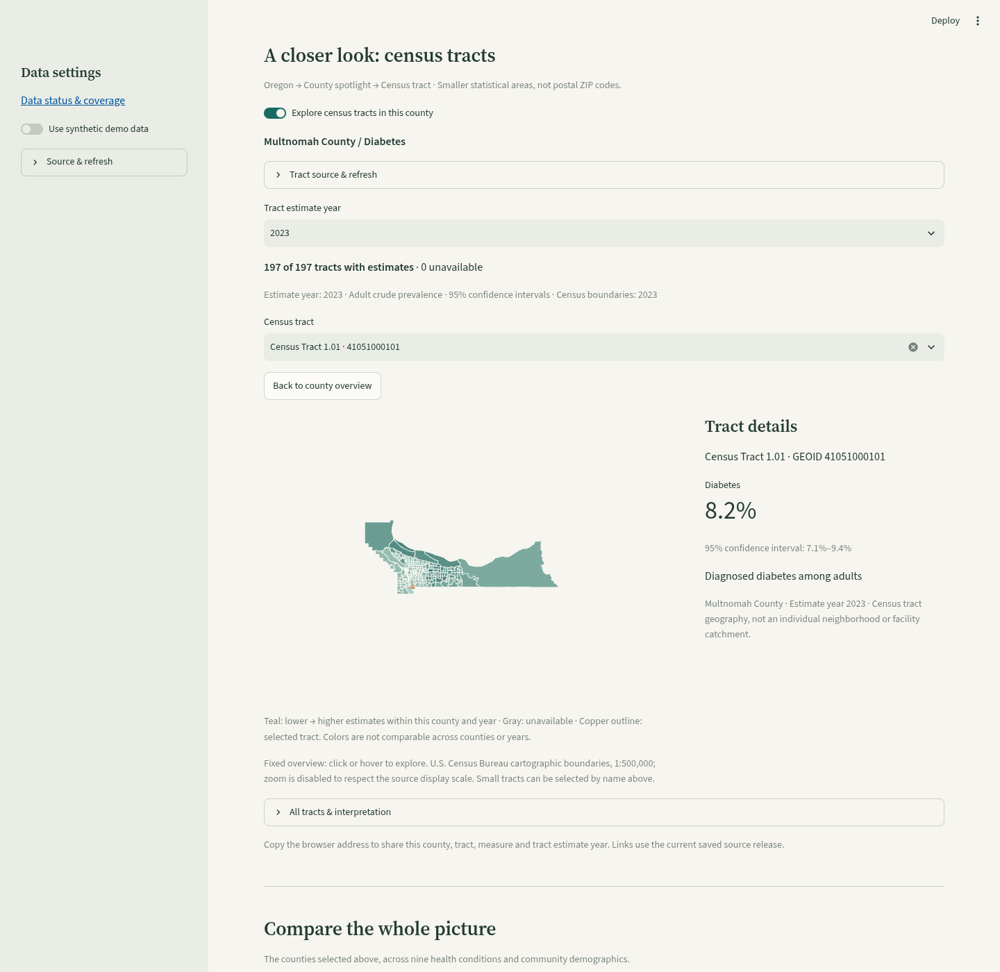

# Health Atlas

**▶ Live app: [health-atlas.streamlit.app](https://health-atlas.streamlit.app/)**

An interactive Streamlit app for exploring county and census-tract health in Oregon and Washington. It maps nine adult health conditions from CDC PLACES and adds Census demographics, CMS hospital listings and HRSA shortage designations alongside them. The pipeline is Python and DuckDB.



## What you can do

| View | What it does |
| --- | --- |
| Explore counties | Map a measure and year, open a county profile, and drill into census tracts |
| Compare counties | Compare conditions side by side, with optional Census demographics, and export to CSV |
| Service areas | Define a group of counties, then summarize it or compare it with a second group |
| Healthcare access | Search CMS hospitals, map approximate addresses, and explore HRSA shortage areas |
| Sources & methods | Check data freshness, coverage gaps and how to read the estimates |

The browser URL keeps your selections, so you can copy it to share a view, for example a [Multnomah County diabetes profile](https://health-atlas.streamlit.app/?county=41051&year=2023&measure=DIABETES&demo=0).

## Data sources

| Source | Used for | Key needed |
| --- | --- | --- |
| [CDC PLACES](https://www.cdc.gov/places/) (2025 county and tract releases) | Prevalence estimates with 95% confidence intervals | No |
| [Census ACS 5-year](https://www.census.gov/data/developers/data-sets/acs-5year.html) | Population, age 65+, poverty | Yes (`CENSUS_API_KEY`) |
| [CMS Hospital General Information](https://data.cms.gov/provider-data/dataset/xubh-q36u) | Hospital directory | No |
| [Census Geocoder](https://geocoding.geo.census.gov/) | Approximate hospital locations | No |
| [HRSA shortage areas](https://data.hrsa.gov/tools/gis-developer-tools) | Health Professional Shortage Areas | No |

Each source is fetched on demand, validated, and cached as a DuckDB snapshot that is replaced atomically. A failed refresh keeps the last good snapshot. No real data is committed to the repo.

**Reading the numbers:** PLACES values are modeled estimates of crude prevalence, not patient records. Comparisons describe differences; they don't show causes or statistical significance. Nothing here is medical advice.

## Run locally

Requires Python 3.12+ and [uv](https://docs.astral.sh/uv/).

```sh
uv sync --frozen
uv run streamlit run app.py
```

CDC data downloads on first use, and no key is required for it. To load Census demographics, set `CENSUS_API_KEY` in your environment or in Streamlit secrets ([get a key](https://api.census.gov/data/key_signup.html)). For offline use, turn on **Use synthetic demo data** in the sidebar (Oregon only).

Run the tests with `uv run pytest -q`. They use synthetic fixtures and need no network access.

## Project layout

```
app.py                      Streamlit shell and view dispatch
oregon_health/
  navigation.py             URL routing and persistent selections
  county_ui.py              County map, profile and comparison views
  import_data.py, data.py   CDC import, validation and DuckDB queries
  api_cache.py              Cache expiry and refresh
  census.py, tracts.py      ACS demographics and tract estimates
  hospitals.py, hrsa.py     CMS hospitals and HRSA shortage areas
  regions.py                Oregon/Washington configuration
tests/                      Unit and app interaction tests
```

## More documentation

- [Reference](docs/reference.md): detailed behavior of each view, the source contracts, share-link parameters, command-line importers, and the refresh and deployment model
- [Washington release check](docs/region-release-check.md)
- [Boundary provenance and licensing](assets/README.md)
- [Contributing](CONTRIBUTING.md) · [Security](SECURITY.md)
