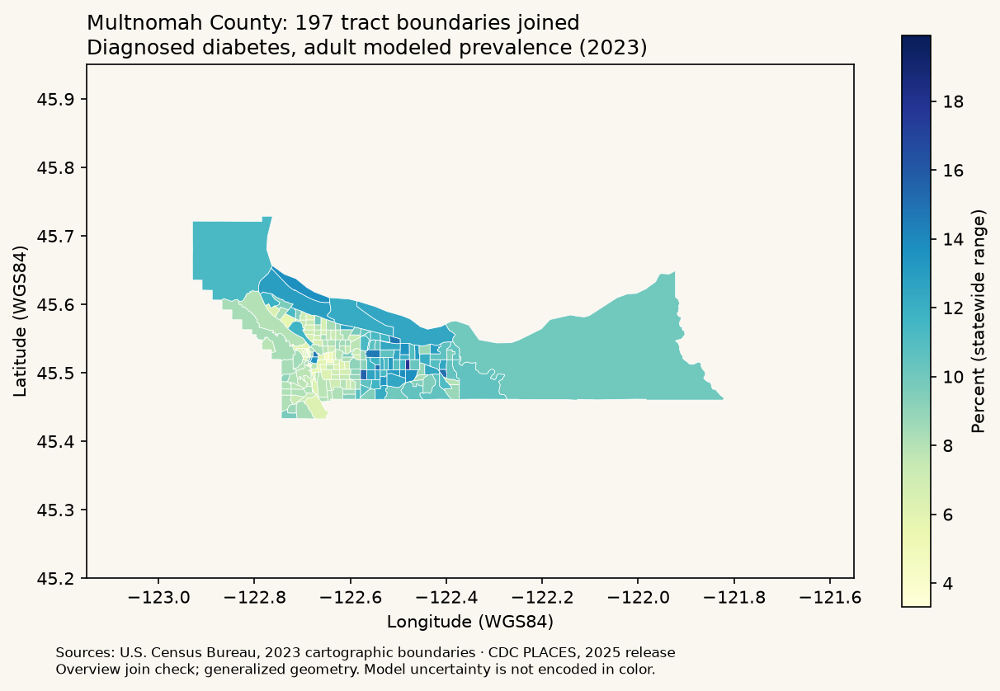

# Oregon county boundaries

`oregon-counties.geojson` is the Oregon subset of Plotly's `geojson-counties-fips.json`, retrieved October 21, 2026 at commit `0c447c47b757ad74edecab31f0d72f849d2e67c2`:

https://github.com/plotly/datasets/blob/0c447c47b757ad74edecab31f0d72f849d2e67c2/geojson-counties-fips.json

The publisher distributes the dataset repository under the MIT license, reproduced in `BOUNDARIES-LICENSE.txt`. This project filtered feature IDs beginning with `41`, retained all 36 county geometries, and reduced properties to `fips` and `name`. Coordinates are retained as longitude/latitude without reprojection. County geometry has not been independently certified against a current Oregon cadastral source; these generalized boundaries are for visualization, not surveying or legal use. No boundary vintage is inferred from the CDC release year.

Join estimates on five-digit FIPS strings, never display names. The map renders bundled polygons without an external tile provider or runtime GIS download. Missing health records remain gray and do not become zero. Light/dark shades are scaled to available estimates for each selected measure/year, so colors are not directly comparable across measures or years. Copper outlines indicate counties selected in the comparison control.

# Oregon tract boundaries (2023)

`oregon-tracts-2023.geojson` contains **994** Census tract Polygon/MultiPolygon features from the U.S. Census Bureau's [2023 Oregon cartographic boundary ZIP, 1:500,000](https://www2.census.gov/geo/tiger/GENZ2023/shp/cb_2023_41_tract_500k.zip), retrieved 2026-10-22. Census permits reuse in products/publications with acknowledgement; its exact source use constraints are reproduced in `TRACT-BOUNDARIES-NOTICE.txt`. The county dataset's MIT notice does not apply to this artifact.

The source NAD83 / EPSG:4269 coordinates were transformed to WGS84 / EPSG:4326 using pyproj with explicit longitude/latitude order and no ballpark transformation. Ring direction is normalized to RFC 7946 (counterclockwise exteriors, clockwise holes); coordinates are rounded to six decimals. All source features, rings, holes and islands are retained, with no additional simplification. Six decimal places do not imply survey accuracy: the source is generalized and the datum operation does not establish precise address coordinates. Properties retain text `geoid` (11 digits), `county_fips` (five digits) and `name`; feature `id` equals `geoid`.

The companion `oregon-tracts-2023.provenance.json` records source/output SHA-256 hashes, byte sizes, source retrieval date, preparation time, boundary vintage, scale, CRS/axis order, build-library versions, attribution and constraints. The **2,588,656-byte** artifact is bundled; loading or filtering it needs no network, map tile key, GIS dependencies or runtime downloads.

Reproduce it without modifying runtime dependencies:

```sh
# Download the official ZIP linked above, then:
uv run --with pyshp==3.1.4 --with pyproj==3.7.2 \
  python scripts/prepare_tract_boundaries.py /path/to/cb_2023_41_tract_500k.zip
```

The build script verifies the pinned ZIP checksum and source CRS, reads archive members in memory, transforms/validates polygons and sorts features by GEOID. A source revision with a different hash requires explicit review rather than silently replacing the file. Preparation time changes when rebuilding; the geometry checksum should remain identical under the recorded toolchain.

`oregon_health.tract_boundaries.boundaries(county_fips=None)` returns an independently mutable collection; `provenance()` returns the source record. `join_estimates(rows, county_fips=None, estimate_boundary_year=2023, previous=None)` takes a single measure/year's tract rows, joins **by GEOID**, retains every boundary, and adds explicit `available`, `unavailable` (row with null estimate), or `no_record` status and null values. Future map layers should show missing/unavailable values with a distinct neutral style, not zero prevalence. Its report lists unmatched estimates, boundaries without records, null estimates, and—when given prior geometry—added/removed IDs and coordinate differences. No prior comparison is `null`, not a claim of no changes. Coordinate differences are not a certified crosswalk. Incompatible vintages fail rather than inheriting values by proximity or name.

Verified against the 2025 CDC tract release: all **993** Oregon estimate GEOIDs match. **41045940000** (Malheur) has a boundary but no CDC record; its absence is unexplained and must not be relabeled as zero or suppressed. Multnomah County has **197/197** matching tracts. These are dated validation baselines. Boundary vintage, CDC release year and estimate year remain distinct.

**Display constraints:** Census specifies small-scale thematic display only, no larger than 1:500,000. Future map navigation must respect that constraint; use a separately reviewed, appropriate source for street-level detail. Do not use these polygons for address geocoding, precise spatial relationships, area/perimeter calculations, facility eligibility, service areas or travel-time analysis. Postal ZIP codes and ZCTAs are not census tracts. The bundled county and tract products also have different provenance and may not align exactly; do not infer vintage compatibility from their names.

Standalone visual validation of the **bundled, transformed** artifact against a saved CDC snapshot: all 197 Multnomah tracts matched for diabetes, estimate year 2023. This preview checks the join and visible geometry, not a deployed app screen or an analysis of uncertainty.



# Washington county boundaries (development target)

`washington-counties.geojson` contains all **39** Washington counties filtered from the same Plotly dataset commit as the Oregon county asset: `0c447c47b757ad74edecab31f0d72f849d2e67c2`, retrieved 2026-10-23. Source:

https://github.com/plotly/datasets/blob/0c447c47b757ad74edecab31f0d72f849d2e67c2/geojson-counties-fips.json

The MIT notice in `BOUNDARIES-LICENSE.txt` applies. The transformation retains IDs beginning with `53`, reduces properties to `fips` and `name` (source `NAME`), sorts features by ID and writes compact JSON plus a trailing newline. Coordinates are unchanged longitude/latitude; no reprojection or additional simplification was performed. Boundary vintage remains **unverified**; these generalized display polygons are not a precise spatial eligibility or cadastral source.

Artifact: **54,680 bytes**, SHA-256 `bcfe4e9b41f56419ece9807ce16ee5aac651ed293e72cc53105ef9102ca6e2fc`. Region validation checks unique five-digit IDs, the state prefix and coordinate bounds. This asset is used by the Washington county-health/ACS explorer. Washington tract and service-area workflows remain unsupported; see the [release verification](../docs/region-release-check.md).
