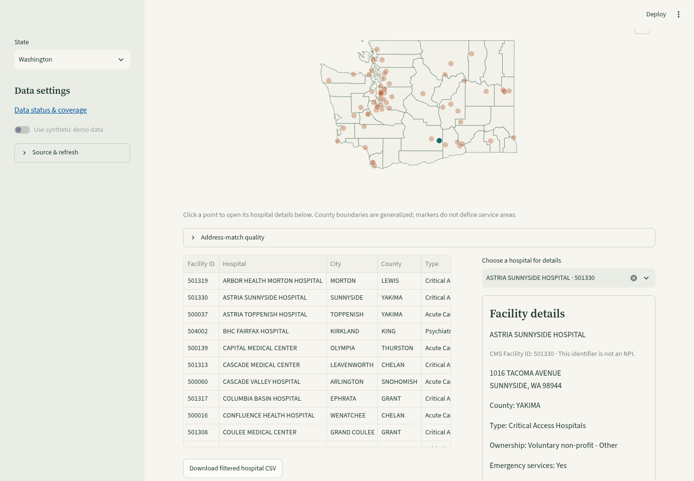

# Washington hospital address locations

In Washington, enable **Show hospital directory**, then **Show approximate hospital locations**. The map uses only accepted Census address matches. Clicking a point opens the same facility details as the keyboard-accessible hospital selector. Search/type/county filters apply to the map and directory together. No map or Census Geocoder API key is required.

## Verified source snapshot — 2026-10-24

The official [Census Geocoder](https://geocoding.geo.census.gov/) batch endpoint resolved `Public_AR_Current` to benchmark ID `4` for the 100 CMS-listed Washington hospital addresses:

| Result | Listings | Coordinates displayed/exported |
| --- | --- | --- |
| Exact, finite and source-county-consistent | 66 | Approximate points |
| Non-exact | 28 | Withheld |
| Ambiguous/tied | 2 | Withheld |
| Unmatched | 4 | Withheld |

All 100 listings remain in the directory and CSV. No ZIP/county centroid, fuzzy match or replacement coordinate is invented. Oregon's existing cached snapshot still retained its 53 accepted points across 62 listings after the additional read-time checks.

Matches are street-address interpolation, **not verified buildings, entrances, campuses, travel times or address eligibility**. CMS listings do not establish current capacity or demand. Only published facility ID/address/city/state/ZIP fields are sent to the fixed official batch endpoint; search text, health estimates, API keys and patient data are not sent. The existing 200-address, bounded-response, no-redirect, timeout and shared request-budget protections apply.

Before acceptance, the integration requires `Exact`, finite coordinates inside configured state bounds, a nonempty standardized address and a known source county containing the point. County checks use the bundled generalized county polygons (Washington SHA-256 `bcfe4e9b41f56419ece9807ce16ee5aac651ed293e72cc53105ef9102ca6e2fc`). Their vintage is unverified. Border matches may be conservatively withheld and need review; this check is not a precise spatial validation or evidence of historical geography alignment.

## Caches, provenance and failures

Washington uses `data/regions/wa/hospital_locations.duckdb`; Oregon retains `data/hospital_locations.duckdb`. State identity is checked before cache read, reservation or replacement; legacy snapshots without state identity remain Oregon-only. Atomic publication uses the existing local snapshot lock. Network/validation/disk failures retain the previous snapshot, subject to the same five-minute attempt cooldown and 30-day match cache.

Address fingerprints include state and source county. Changed addresses never inherit old coordinates. Cached accepted points are rechecked against current bounds/county geometry before display or export; incomplete source addresses, missing matched addresses and contradictory coordinates are withheld. A boundary hash change triggers refresh; legacy snapshots remain readable until the next successful refresh adds identity/hash metadata. Oregon-only quality audits reject Washington location snapshots rather than assigning them to Oregon.

The hospital CSV preserves source records even when locations are missing. It includes match status, address hash, Census source, benchmark name/ID, fetch time, state FIPS, boundary SHA-256 and address-set fingerprint. Rejected/unmatched/changed records have blank coordinates. `coordinate_status` still correctly says CMS does not supply coordinates; any displayed point comes from the separate Census source. IDs/ZIPs remain strings; spreadsheet-formula prefixes are escaped.

A geocoder outage leaves hospital search/details and health estimates usable. Retained matches are labeled with source/fetch dates, and only unchanged, currently valid addresses retain points. An empty match cache shows unmapped listings, not zero hospital coverage.

## Reproduce

```sh
uv sync --frozen
uv run pytest -q tests/test_washington_locations.py tests/test_geocoding.py tests/test_hospital_ui.py
uv run streamlit run app.py
```

No live request or key is needed for synthetic tests. They cover batch state fields, mismatched states/counties, exact/non-exact/ambiguous/missing responses, finite/bounds/county checks, cache isolation, legacy migration, changed addresses, invalid cached points, disk failure, exports and retained-data behavior. Full pytest and Bandit are required before merge. Browser checks cover desktop/mobile maps, point picking or keyboard details, 100-row exports including all 34 withheld matches, no horizontal overflow and no browser errors.


