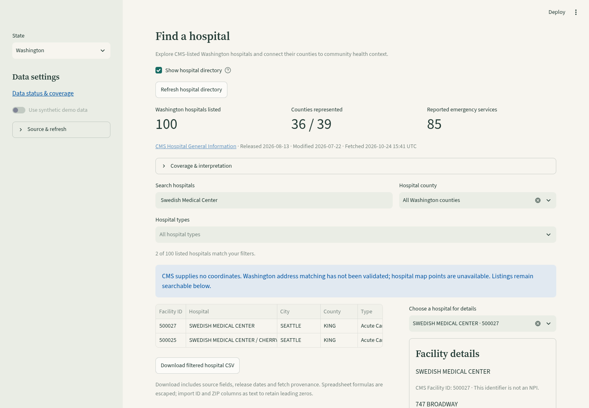

# Washington hospital directory

Choose Washington in the sidebar, then **Hospitals → Show hospital directory**. Search by public facility attributes, filter by county/type, select a facility for details, download the filtered CSV, or open its Washington county profile. Loading CMS is opt-in and independent of health/Census requests. The directory remains usable when CDC is unavailable; county profile navigation then explains that health data is needed.

## Source and verified coverage

Official source: [CMS Hospital General Information, `xubh-q36u`](https://data.cms.gov/provider-data/dataset/xubh-q36u). Verified 2026-10-24 against the official metadata-resolved national CSV:

| Snapshot | Listings | Counties with listings | Unresolved county links | Incomplete addresses | Emergency status unreported |
| --- | --- | --- | --- | --- | --- |
| Oregon | 62 | 32 / 36 | 0 | 0 | 0 |
| Washington | 100 | 36 / 39 | 0 | 0 | 0 |

Source released **2026-08-13**, modified **2026-07-22**. Both state imports used the same national CSV SHA-256 `f874f09fef895a1ccf5bb7392dcbb2be05c9860339261b093fe00f0c1b013480`. State partitions were about 1.06 MB each and each live download/validation/publication completed in under one second in the cloud workspace; this is an observation, not a browser latency guarantee.

Douglas (`53017`), Skamania (`53059`) and Wahkiakum (`53069`) have no listed rows in this snapshot. This does **not** establish that healthcare is unavailable there. CMS does not list every clinic/campus, and listings or emergency-services status do not establish current capacity, specialties, unmet need or purchase intent. Facility IDs are CMS source strings, not NPIs or county FIPS; no state-prefix rule is inferred from a CMS ID.

CMS supplies **no coordinates**. Washington address matching has not been validated, so this release creates no points and does not offer the geocoding toggle. CSVs retain the source state, county/FIPS, IDs, dates and file hash, mark coordinates as not supplied by CMS, and leave location/benchmark fields blank. They escape spreadsheet formulas; import ID and ZIP columns as text. Oregon's separate, opt-in Census address matching remains available.

## Storage and failure behavior

Oregon keeps `data/hospitals.duckdb`; Washington uses `data/regions/wa/hospitals.duckdb`. State identity is stored in provenance. Legacy provenance without a state marker is Oregon-only and gains an explicit marker after a successful replacement. Foreign-state reads/refreshes/replacements are rejected before network access; changed addresses cannot inherit Oregon location records because the Washington geocoder is disabled.

Publications use the existing local POSIX file lock and atomic snapshot helper. Validation, duplicate keys, conflicting writers or disk replacement failures retain the previous snapshot. Imports preserve unresolved counties as NULL rather than guessing. CMS state/county joins use the configured catalog; coverage uses 36 or 39 counties accordingly. The national CSV remains bounded to 10 MB/25,000 rows; the daily cache, five-minute per-cache cooldown and shared CMS-host request budget still apply. Independent writable replicas remain unsupported.

## Reproduce

```sh
uv sync --frozen
uv run pytest -q tests/test_washington_hospitals.py tests/test_hospitals.py tests/test_hospital_ui.py
# Optional official live import; no CMS key is needed.
uv run python -m oregon_health.hospitals --region WA
uv run streamlit run app.py
```

Synthetic tests cover both state catalogs, ID/ZIP strings, unresolved counties, leading zeros, identity isolation, legacy Oregon caches, disk failure, opt-in filtering/details, correct county navigation and source outages with/without a saved snapshot. Desktop/mobile checks cover the 100-row CSV, source provenance, absence of coordinates/geocoder controls, literal search and Washington county navigation. The full pytest and Bandit checks are required before merge.


