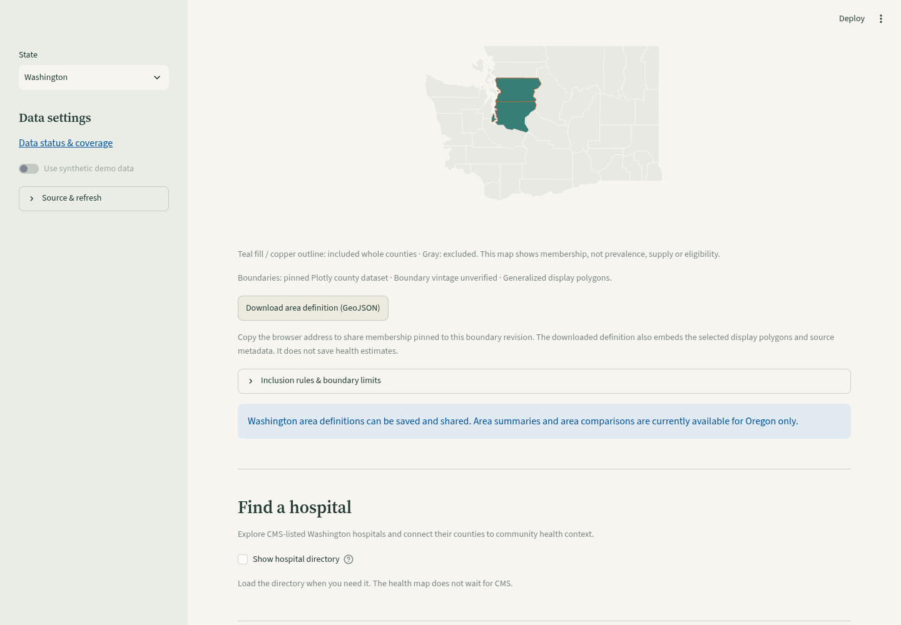

# Washington whole-county service areas

Select Washington, then **Service area**. Choose any of its 39 counties, preview membership, download a GeoJSON definition, load a saved definition or copy the browser address. Membership is independent of the health condition, comparison counties, county spotlight and source availability. Empty and disconnected sets are valid; duplicate county IDs are removed.

Washington definitions now also support optional [saved-source summaries](washington-area-summaries.md). Washington area-to-area comparisons remain disabled pending their separate state-aware rollout. Oregon keeps its existing summary/comparison workflows. A definition contains no health estimates, population totals, facility counts or commercial-demand calculation.

## Reproducibility and state safety

Washington definitions use the same schema version 1 and whole-county inclusion rule as Oregon, with `state_fips: "53"`, the exact selected display polygons and the Washington artifact hash. The boundary source is the pinned MIT-licensed Plotly county dataset; Washington SHA-256 is `bcfe4e9b41f56419ece9807ce16ee5aac651ed293e72cc53105ef9102ca6e2fc`. Boundary vintage remains unverified. This is display geography, not a precise catchment, service eligibility, physical-area calculation or drive-time zone.

Links carry `state=WA`, a canonical sorted `area` county-ID list and the `area_rev` boundary hash. All 39 counties round-trip within the state-specific link limit. Oregon's existing links retain their original format and revision. Switching states clears previous membership and view state. An explicit empty definition remains shareable.

Imports accept only the current exact definition for the active state, capped at **250 KB**. Foreign-state definitions (including empty ones), unknown county IDs, stale revisions, changed polygons/rules, duplicate JSON keys, non-finite values and extra metadata are rejected. A rejected upload retains the current selection. No external URLs are fetched, no file contents are logged, and no patient/client addresses or uploaded address lists are used.

The current full-state exports are **55,499 bytes for all 39 Washington counties** and **35,805 bytes for all 36 Oregon counties**, within the existing import budget. Both exact round-trips are covered by synthetic CI checks. No new API requests, keys, domains, dependencies or source snapshots are required by the builder.

## Verification — 2026-10-24

```sh
uv sync --frozen
uv run pytest -q tests/test_washington_service_areas.py tests/test_service_areas.py
uv run streamlit run app.py
```

Tests cover both complete county catalogs, empty/duplicate selections, state/revision-pinned links, file tampering, membership-only maps, state switching, unavailable CDC data and opt-in summary loading and prevention of calls to Oregon-only comparison code. Browser checks at 1440×1000 and 390×844 exercise county selection, GeoJSON download, valid re-import, rejection of Oregon/modified files without losing membership, all-39-county links, legacy Oregon links and no browser errors or horizontal overflow.

Whole-county membership is an analytical choice. People can cross borders for care, two definitions can overlap, and county selection alone does not establish where clients live or where services are delivered. Cross-area results must account for shared counties rather than adding overlapping totals.


