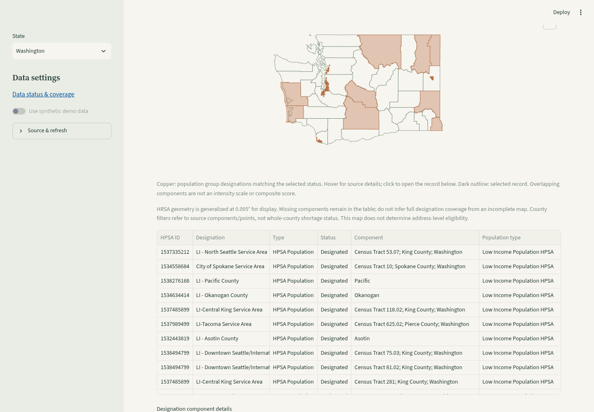

# Washington HRSA shortage designations

Select Washington, then **Shortage designations → Show HRSA shortage designations**. Primary care, dental health and mental health each have separate geographic/population components and facility designation points. Filters, legends, map picking, accessible component details and CSV export mirror Oregon's view. This is an independent opt-in source; hospital listings and CDC estimates do not wait for it.

## Live source verification — 2026-10-24

Official [HRSA HPSA GIS service](https://gisportal.hrsa.gov/server/rest/services/Shortage/HealthProfessionalShortageAreas_FS/MapServer); [HRSA source and interpretation](https://data.hrsa.gov/topics/health-workforce/shortage-areas). The source warehouse date was **2026-10-23** in both state imports.

| Washington layer | Facility point records | Component polygon records |
| --- | --- | --- |
| Primary Care (9 / 11) | 163 | 1,229 |
| Dental Health (1 / 3) | 164 | 718 |
| Mental Health (5 / 7) | 166 | 1,096 |

Washington totals: **3,536 source records / 732 distinct (discipline, HPSA ID) pairs**; 2,335 Designated and 1,201 Proposed For Withdrawal records. Categories: 1,271 Geographic, 1,772 Population group, 493 Facility records. These are components or administrative designation points, not people, clinicians, verified hospital sites, capacity or market demand. One designation can have multiple components and overlap another designation.

There are **181 records without geometry** (109 population-group components, 68 geographic components, 4 facility points). They remain in tables and exports. One primary-care facility record has source county code `XXXXX`: its county join remains unresolved rather than guessed. All other county links resolve to Washington's configured county catalog. Missing geometry and unresolved county counts describe different, potentially overlapping fields; do not add them as a single missing-record total.

Oregon regression: **874 records / 464 (discipline, HPSA ID) pairs**, 553 Designated / 321 Proposed For Withdrawal, 37 records without geometry and one unresolved county link. Washington's local file was about 2.11 MB; its live six-layer download/validation/publication took about 24.6 seconds in this workspace. This observation is not a browser latency guarantee.

The public GIS view returned Designated and Proposed For Withdrawal records, **not complete withdrawn history**. HRSA's separate downloads include withdrawn records. No rows for the Withdrawn filter do not prove that no designations were withdrawn. Proposed withdrawal is distinct from a completed withdrawal.

## Geography and identifiers

Polygon queries select the source component state FIPS `53`. Facility queries use `PRIMARY_STATE_FIPS_CD = '53' OR CMN_STATE_FIPS_CD = '53'`. Source primary/common/component state fields are preserved separately from the query region. If HRSA includes a cross-state facility designation, a foreign source county is retained but not assigned to a Washington county. The query membership rule is not a new spatial eligibility test.

Geometry is generalized by the source at **0.005°** and checked for supported types, finite coordinates, closed rings and vertex bounds. It does not determine address eligibility, precise service areas or historical tract alignment. County filters refer to source components/facility points, not whole-county shortage status. Population-group polygons describe the reported population group, not every resident in their footprint.

HRSA's ten-character HPSA IDs can contain letters. They are not CMS Facility IDs or NPIs. Source layer/object IDs identify features in this snapshot, not durable cross-release component IDs. No CMS/HRSA facility identity matching, combined facility counts, prevalence overlay or demand score is added.

## Storage, failures and provenance

Oregon retains `data/hrsa.duckdb`; Washington uses `data/regions/wa/hrsa.duckdb`. State identity is stored in provenance and checked before cache read, refresh requests and replacement. Legacy JSON provenance without a state marker is Oregon-only and gains explicit identity on successful refresh. Oregon-only quality/service-area readers reject Washington snapshots.

Publication uses the existing local POSIX lock and atomic snapshot helper. A failed source request, validation error, competing writer or disk replacement failure preserves the saved file. Queries still use the bounded ID index, 100-ID batches, at most 5,000 features, 20 MB per response, no redirects, timeouts, daily cache and shared request/cooldown limits. A truncated or oversized response is rejected, not silently clipped.

The full-snapshot caption reports missing geometry and unresolved counties; the cards report the current filters. CSVs preserve IDs, state/query membership, status, source county, component/population fields, designation/warehouse dates, geometry availability, source, fetch time and generalization. Missing source values remain blank. Spreadsheet formulas are escaped; import identifiers as text.

The HRSA refresh-outcome identifier is now retained instead of sanitized to a different identifier. Fresh retained snapshots therefore show a failure warning too. Existing legacy outcomes under `invalid-source` remain readable through a fallback restricted to the HRSA cache. Other unrecognized status identifiers are still sanitized.

## Reproduce

```sh
uv sync --frozen
uv run pytest -q tests/test_washington_hrsa.py tests/test_hrsa.py tests/test_status.py
# Optional official live import; no API key is needed.
uv run python -m oregon_health.hrsa --region WA
uv run streamlit run app.py
```

CI fixtures are synthetic, small and secret-free. They cover six-layer state filters, cross-state membership, missing geometry, isolated caches, legacy migration, disk failures, refresh outcomes and retained/unavailable-source views. Browser checks exercise all disciplines/categories and CSVs on desktop, category switching and accessible details on mobile, point picking, map rendering and no horizontal overflow. Full pytest and Bandit are required before merge. Tracts and whole-county service-area workflows remain Oregon-only; this is not nationwide coverage.


